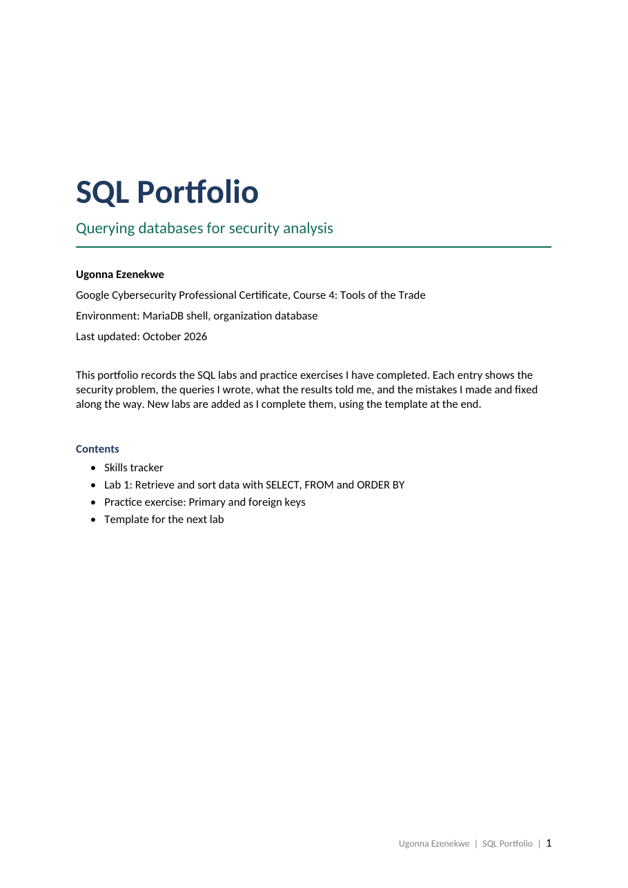
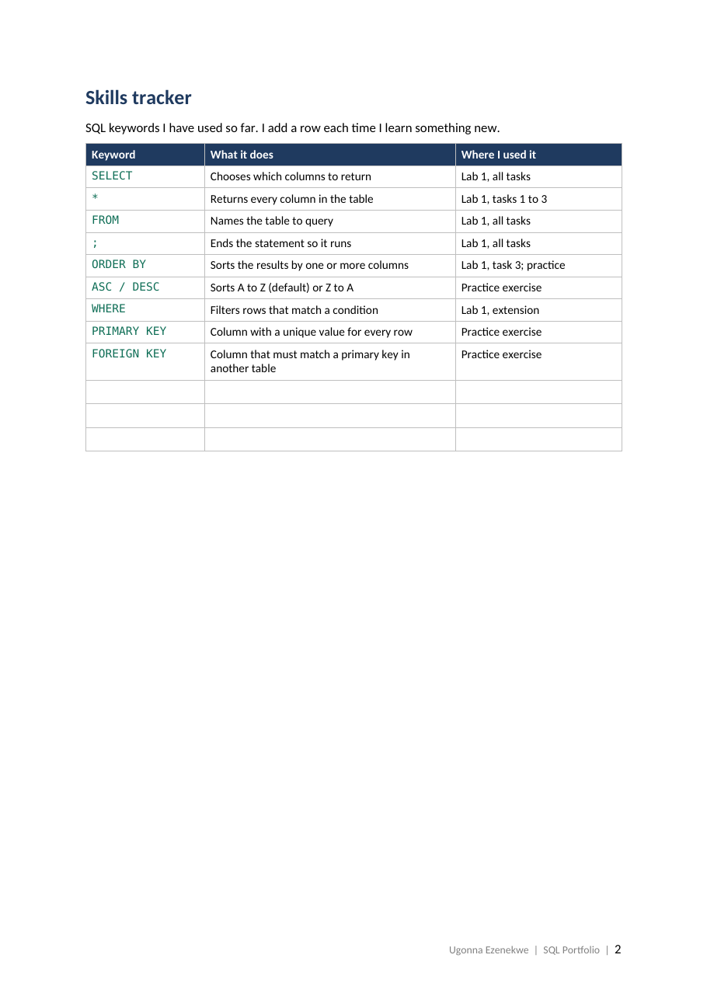
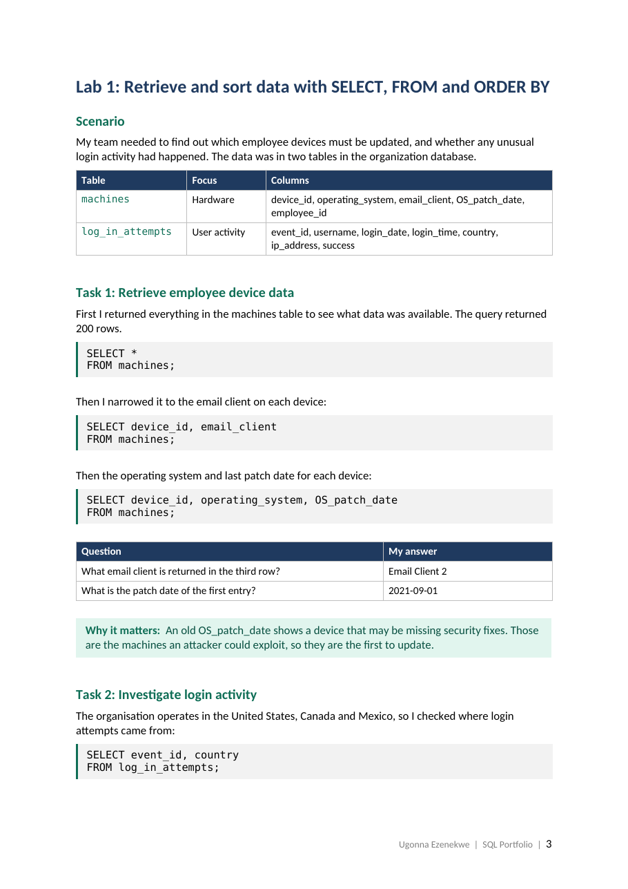
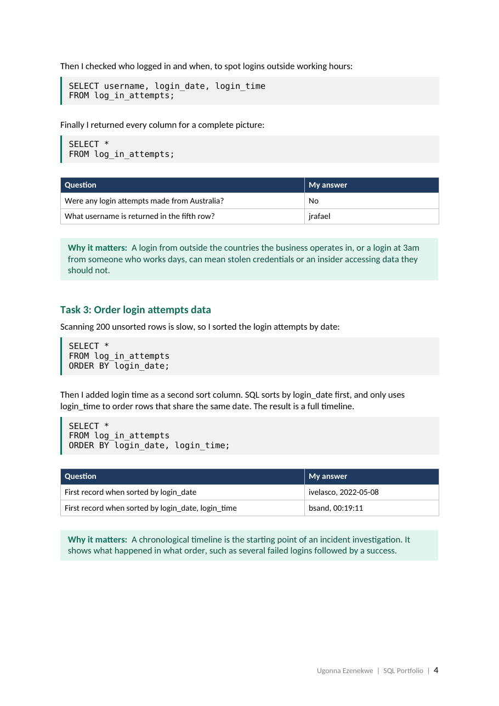
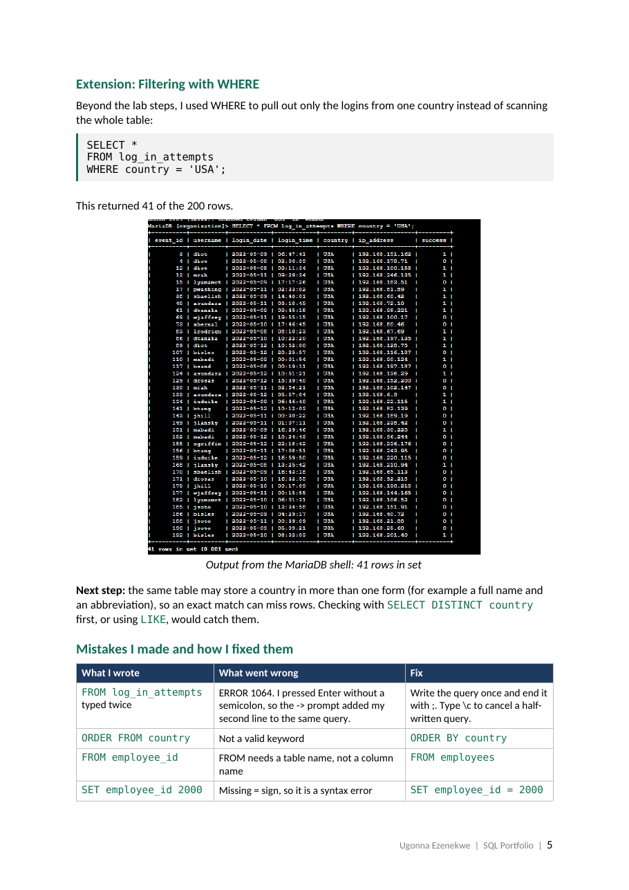
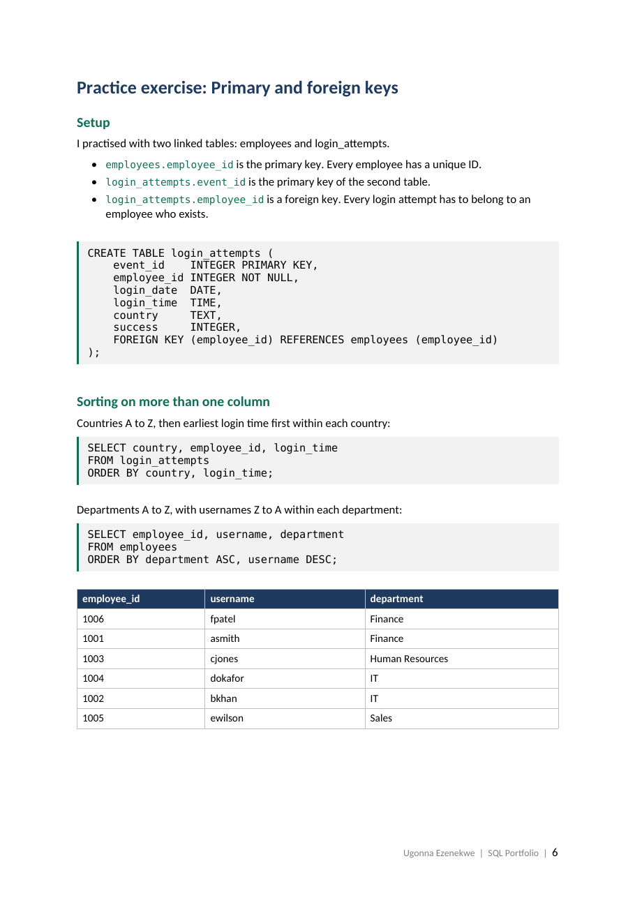
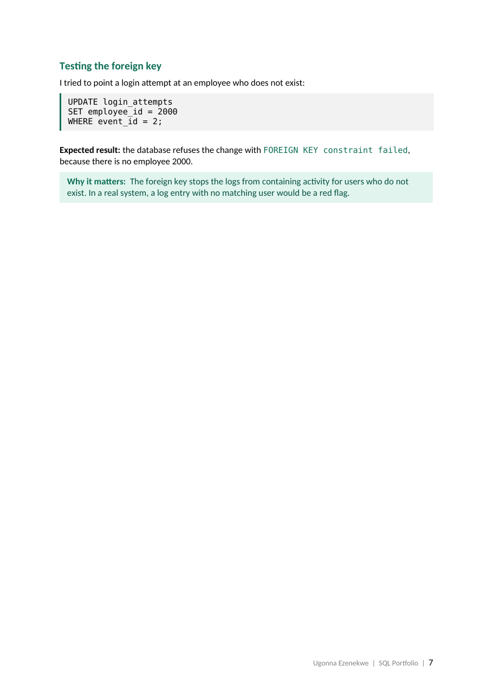
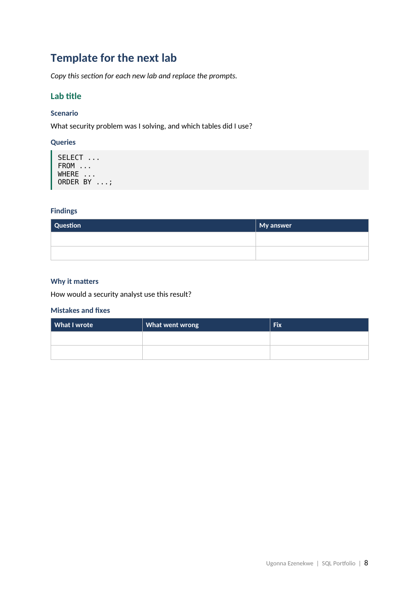

# SQL for Security Analysis

SQL labs and practice exercises from the **Google Cybersecurity Professional Certificate** (Course 4: Tools of the Trade).

Each lab shows the security problem, the queries I wrote, what the results told me, and the mistakes I made and fixed along the way.

**Environment:** MariaDB · `organization` database

📄 **[View the full portfolio (PDF)](docs/SQL_Portfolio.pdf)**: every lab written up with queries, findings and the security reasoning behind them.

## Portfolio preview

<table>
<tr><td><a href="docs/pages/page-1.png"></a></td><td><a href="docs/pages/page-2.png"></a></td></tr>
<tr><td><a href="docs/pages/page-3.png"></a></td><td><a href="docs/pages/page-4.png"></a></td></tr>
<tr><td><a href="docs/pages/page-5.png"></a></td><td><a href="docs/pages/page-6.png"></a></td></tr>
<tr><td><a href="docs/pages/page-7.png"></a></td><td><a href="docs/pages/page-8.png"></a></td></tr>
</table>

## Labs

| # | Lab | Skills | Status |
|---|-----|--------|--------|
| 1 | [Retrieve and sort data](labs/01-select-from-order-by/) | `SELECT` `FROM` `ORDER BY` `WHERE` | ✅ Complete |

## Practice

| Exercise | Skills |
|----------|--------|
| [Primary and foreign keys](practice/primary-foreign-keys/) | `PRIMARY KEY` `FOREIGN KEY` `ASC` `DESC` |

## Skills tracker

| Keyword | What it does |
|---------|--------------|
| `SELECT` | Chooses which columns to return |
| `*` | Returns every column |
| `FROM` | Names the table to query |
| `ORDER BY` | Sorts results by one or more columns |
| `ASC` / `DESC` | Sorts A to Z (default) or Z to A |
| `WHERE` | Filters rows that match a condition |
| `PRIMARY KEY` | Unique value for every row |
| `FOREIGN KEY` | Must match a primary key in another table |

## Repo structure

```
sql-for-security/
├── README.md
├── docs/
│   ├── SQL_Portfolio.pdf
│   └── pages/
├── labs/
│   └── 01-select-from-order-by/
│       ├── README.md
│       ├── queries.sql
│       └── screenshots/
└── practice/
    └── primary-foreign-keys/
        ├── README.md
        └── practice_keys.sql
```
