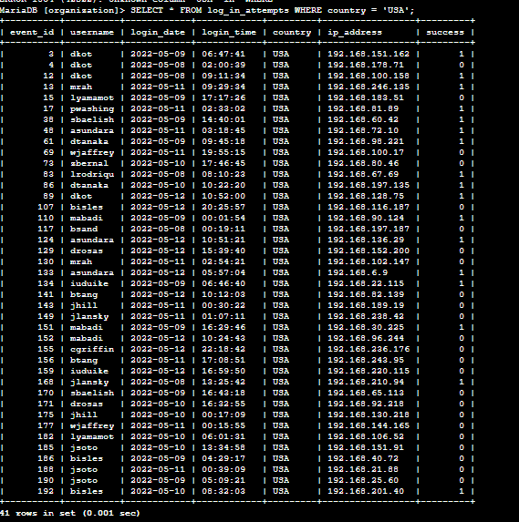

# Lab 1: Retrieve and sort data with SELECT, FROM and ORDER BY

## Scenario

My team needed to find out which employee devices must be updated, and whether any unusual login activity had happened.

| Table | Focus | Columns |
|-------|-------|---------|
| `machines` | Hardware | device_id, operating_system, email_client, OS_patch_date, employee_id |
| `log_in_attempts` | User activity | event_id, username, login_date, login_time, country, ip_address, success |

All queries are in [`queries.sql`](queries.sql).

## Task 1: Retrieve employee device data

```sql
SELECT device_id, operating_system, OS_patch_date
FROM machines;
```

| Question | Answer |
|----------|--------|
| Email client in the third row | Email Client 2 |
| Patch date of the first entry | 2021-09-01 |

> **Why it matters:** an old `OS_patch_date` shows a device that may be missing security fixes. Those are the first machines to update.

## Task 2: Investigate login activity

```sql
SELECT username, login_date, login_time
FROM log_in_attempts;
```

| Question | Answer |
|----------|--------|
| Any login attempts from Australia? | No |
| Username in the fifth row | jrafael |

> **Why it matters:** a login from outside the countries the business operates in, or at 3am from a daytime worker, can mean stolen credentials.

## Task 3: Order login attempts data

```sql
SELECT *
FROM log_in_attempts
ORDER BY login_date, login_time;
```

SQL sorts by `login_date` first, then uses `login_time` to order rows that share a date.

| Sorted by | First record |
|-----------|--------------|
| `login_date` | ivelasco, 2022-05-08 |
| `login_date, login_time` | bsand, 00:19:11 |

> **Why it matters:** a chronological timeline is the starting point of an incident investigation.

## Extension: Filtering with WHERE

```sql
SELECT *
FROM log_in_attempts
WHERE country = 'USA';
```

Returned 41 of 200 rows.



## Mistakes and fixes

| What I wrote | Problem | Fix |
|--------------|---------|-----|
| `FROM log_in_attempts` twice | ERROR 1064: no `;`, so the `->` prompt joined both lines | End with `;`, or type `\c` to cancel |
| `ORDER FROM country` | Not a valid keyword | `ORDER BY country` |
| `FROM employee_id` | `FROM` needs a table, not a column | `FROM employees` |
| `SET employee_id 2000` | Missing `=` | `SET employee_id = 2000` |
